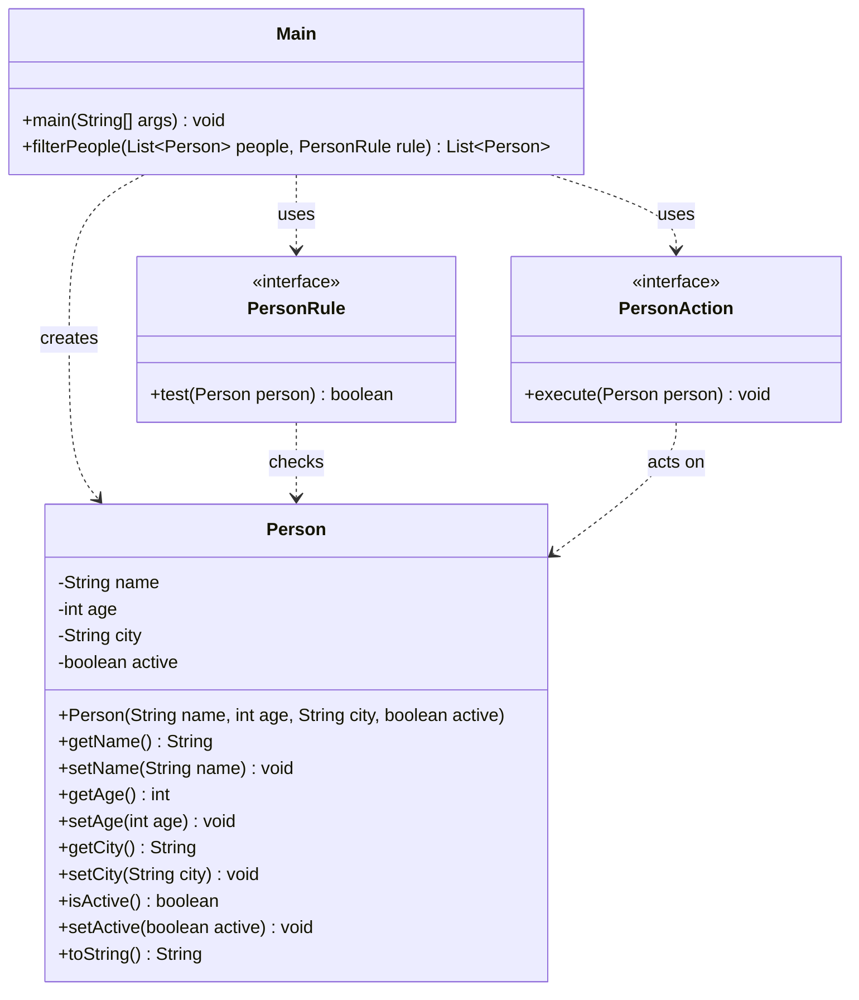
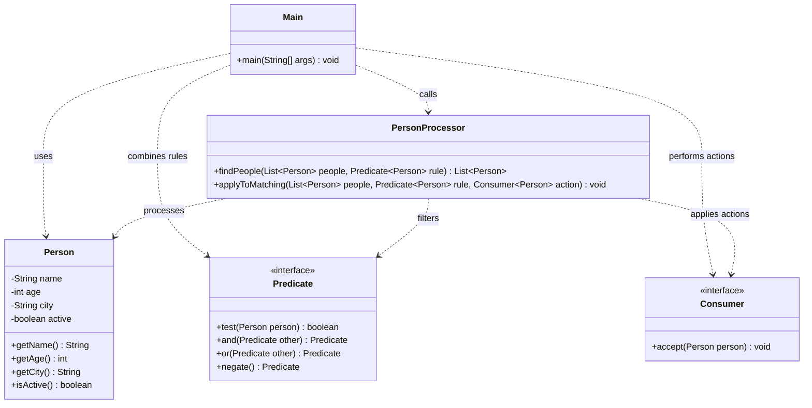

## Reflection Questions

### 1. Which solutions were easier to read: loop-based or stream-based?

I found stream-based solutions easier to read because the code is shorter and simpler.

In Part 1, I used a `for` loop and an `if` condition to filter people.

In Part 2,  used `stream()` and `filter()` to select active people.

Both methods are useful. Loops helped me understand the logic step by step, while streams made the code shorter.

### 2. Which operations felt like transformations and which felt like side effects?

**Data Processing and Transformations:**

- `filter()` -  used it to select active people.
- `map()` - used it to get names from Person objects.
- `sorted()` - used it to sort people by age.
- `count()` - used it to count adults.
- `findFirst()` -  used it to find the first active person living in Stockholm.

**Side Effects:**

- `System.out.println()` -  used it to print results in the console.
- `forEach()` - used it to print each person's information.
- `PersonAction` - used it to print a person's name and an email message.

### 3. Where did Predicate, Function, and Consumer fit naturally?

**Predicate:**

My `PersonRule` functional interface works like a Predicate.

I used it to check whether a person is active, an adult, or lives in Stockholm.

I also used the Predicate idea with `filter()` in Part 2.

**Function:**

I used the Function idea with `map()`.

It takes a Person object and returns the person's name.

**Consumer:**

My `PersonAction` functional interface works like a Consumer.

I used it to print a person's name and display an email message.

I also used the Consumer idea with `forEach()` to print results.


### Optional Exercises

#### Task 5 — Rule Composition
- Created `isActive`, `isAdult`, and `livesInStockholm` rules.
- Used `and()` to find active adults.
- Used `or()` to find adults or people living in Stockholm.
- Used `negate()` to find inactive people.

#### Task 6 — Reusable Processor
- Created `PersonProcessor.java`.
- Implemented `findPeople(list, rule)` to return matching people.
- Implemented `applyToMatching(list, rule, action)` to perform actions.
- Tested both methods in `Main.java`.

#### Task 7 — Prebuilt Interfaces
- Replaced `PersonRule` with `Predicate<Person>` in `PersonProcessor`.
- Replaced `PersonAction` with `Consumer<Person>` in `PersonProcessor`.
- Used built-in functional interfaces with lambda expressions.
- Kept the original custom interfaces for practice.

---

## Part 2 — Stream API

### Optional Exercises

#### Task 6 — Multiple Filters
- Filtered active adults.
- Filtered active people living in Stockholm.
- Filtered inactive people older than 30.

**Results:**
- Active adults: Amina, Sara, Omar.
- Active people in Stockholm: Amina, Omar.
- Inactive people older than 30: Noah, Lina.

#### Task 7 — Distinct and Sorting
- Used `map()` to get city names.
- Used `distinct()` to remove duplicates.
- Used `sorted()` to sort the results.
- Created a sorted list of unique cities.
- Created a sorted list of unique first letters of names.

**Results:**
- Cities: Gothenburg, Malmö, Stockholm, Uppsala.
- First letters: A, E, L, N, O, S.

#### Task 8 — Mapping and Formatting
- Used `map()` to create formatted person details.
- Created strings in the format `Name (age) - city`.
- Used `toLowerCase()` to create email addresses.
- Stored the results in `List<String>`.

**Person Details:**

```text
Amina (22) - Stockholm
Erik (17) - Uppsala
Noah (34) - Stockholm
Sara (29) - Gothenburg
Lina (41) - Malmö
Omar (19) - Stockholm
```

**Email Addresses:**

```text
amina@example.com
erik@example.com
noah@example.com
sara@example.com
lina@example.com
omar@example.com
```


## UML Class Diagram — Core Application



### Core Application Explanation

- `Person` stores the person's information.
- `PersonRule` is a functional interface used to check conditions.
- `PersonAction` is a functional interface used to perform actions.
- `Main` creates Person objects and runs the exercises.
- `filterPeople()` uses a loop to select matching people.
- The Stream API exercises use `filter()`, `map()`, `count()`, `sorted()`, and `findFirst()`.

**Relationship:** The dashed arrows show that one class uses another class or interface.


## UML Class Diagram — Optional Challenges



### Optional Challenges Explanation

#### Part 1 — Functional Programming

**Task 5: Rule Composition**
- Created `isActive`, `isAdult`, and `livesInStockholm`.
- Used `and()`, `or()`, and `negate()` to combine rules.

**Task 6: Reusable Processor**
- Created `PersonProcessor`.
- Used `findPeople()` to find matching people.
- Used `applyToMatching()` to perform actions.

**Task 7: Prebuilt Interfaces**
- Used `Predicate<Person>` instead of `PersonRule`.
- Used `Consumer<Person>` instead of `PersonAction`.

#### Part 2 — Stream API

**Task 6: Multiple Filters**
- Filtered active adults.
- Filtered active people in Stockholm.
- Filtered inactive people older than 30.

**Task 7: Distinct and Sorting**
- Used `map()`, `distinct()`, and `sorted()`.
- Created sorted lists of cities and first letters.

**Task 8: Mapping and Formatting**
- Created formatted person details.
- Created email addresses using `map()` and `toLowerCase()`.

### Relationships

- `Main` calls `PersonProcessor`.
- `PersonProcessor` processes `Person` objects.
- `Predicate` checks conditions.
- `Consumer` performs actions.
- Dashed arrows show dependency relationships.
